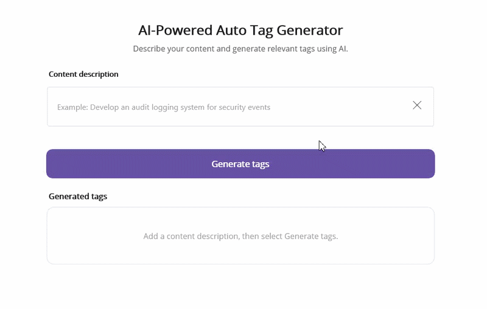

# AI-Powered Tag Generator in .NET MAUI

This sample demonstrates AI-powered tag generation with the Syncfusion .NET MAUI Chips control. The application integrates Azure OpenAI to turn a natural-language description into relevant, context-aware tags that can be displayed as clean chip items.

## Overview

Tag generation is useful in content workflows, feature planning, and product discovery scenarios where users describe intent and need a short, structured set of keywords. This sample uses Azure OpenAI to interpret the description and return only tags from a curated vocabulary, so the results remain accurate, consistent, and UI-friendly.

The AI-generated tags are displayed as chips with a polished loading state and a wrap layout that supports multiple rows without clipping. This makes the sample useful as a reference for smart labeling, content classification, and metadata suggestions inside MAUI applications.

## Key Features

- Syncfusion .NET MAUI Chips integration
- Azure OpenAI-powered tag generation
- Vocabulary-constrained output for valid chip labels
- Natural-language input for feature and content descriptions
- Loading, empty, and results states in the UI
- Wrapping chip layout for responsive display
- Clear and regenerate workflow for repeated prompts
- Cross-platform .NET MAUI application

## Sample

```xaml
<syncfusion:SfChipGroup Grid.Row="0"
    x:Name="chipsControl"
    ItemsSource="{Binding Tags}"
    DisplayMemberPath="Name"
    ChipType="Action"
    ChipBackground="{StaticResource BrandAccent}"
    ChipTextColor="White"
    HorizontalOptions="Fill"
    VerticalOptions="Start">
    <syncfusion:SfChipGroup.ChipLayout>
        <FlexLayout Direction="Row"
                    Wrap="Wrap"
                    JustifyContent="Start"
                    AlignItems="Start"/>
    </syncfusion:SfChipGroup.ChipLayout>
</syncfusion:SfChipGroup>
```

## Output



## Requirements to run the demo

To run the demo, refer to https://help.syncfusion.com/maui/system-requirements

## Prerequisites

Before running the sample, ensure that you have:

- Visual Studio 2022 with .NET MAUI workload installed
- .NET 9 or later
- Azure OpenAI resource and deployment
- Syncfusion .NET MAUI Core/Inputs packages
- Valid Syncfusion license key

## Troubleshooting

### Path too long exception

If you encounter a "Path Too Long" exception while building the project, close Visual Studio, rename the repository folder to a shorter name, and rebuild the project.

## License

Syncfusion has no liability for any damage or consequence that may arise from using or viewing the samples. The samples are for demonstrative purposes. If you choose to use or access the samples, you agree to not hold Syncfusion liable, in any form, for any damage related to use, for accessing, or viewing the samples. By accessing, viewing, or seeing the samples, you acknowledge and agree Syncfusion's samples will not allow you seek injunctive relief in any form for any claim related to the sample. If you do not agree to this, do not view, access, utilize, or otherwise do anything with Syncfusion's samples.
