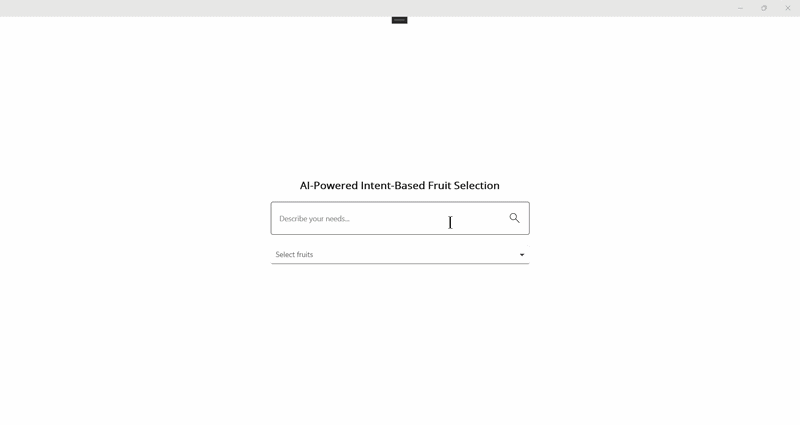

# AI-Powered Multi-Select ComboBox in .NET MAUI

This sample demonstrates AI-driven selection with the Syncfusion .NET MAUI ComboBox. The application integrates Azure OpenAI to understand a natural-language request and automatically select the most relevant fruits in a multi-select ComboBox.

## Overview

Multi-select experiences often require users to identify multiple items from a long list. This sample makes that process smarter by allowing the user to describe their intent in plain language, while the AI maps the request to the available fruit list and updates the ComboBox selection automatically.

The solution is useful for scenarios such as guided filtering, product selection, preference matching, and intelligent item pickers inside MAUI applications.

## Key Features

- Syncfusion .NET MAUI ComboBox integration
- Azure OpenAI-powered intent-based selection
- Multi-select item filtering for fruit choices
- Natural-language request understanding
- Loading, clear, and selection states in the UI
- Structured mapping to a known item list
- Cross-platform .NET MAUI application

## Sample

```xaml
<editors:SfComboBox x:Name="comboBox"
                    WidthRequest="500"
                    SelectionMode="Multiple"
                    IsEditable="False"
                    IsFilteringEnabled="False"
                    DisplayMemberPath="Name"
                    MultiSelectionDisplayMode="Token"
                    ItemsSource="{Binding Foods}"
                    SelectedItems="{Binding SelectedItems, Mode=TwoWay}">
    <editors:SfComboBox.ItemTemplate>
        <DataTemplate x:DataType="local:FoodModel">
            <Grid ColumnDefinitions="0.9*,0.1*">
                <Label Text="{Binding Name}" />
                <CheckBox IsChecked="{Binding IsSelected, Mode=TwoWay}" />
            </Grid>
        </DataTemplate>
    </editors:SfComboBox.ItemTemplate>
</editors:SfComboBox>
```

## Output



## Requirements to run the demo

To run the demo, refer to https://help.syncfusion.com/maui/system-requirements

## Prerequisites

Before running the sample, ensure that you have:

- Visual Studio 2022 with .NET MAUI workload installed
- .NET 9 or later
- Azure OpenAI resource and deployment
- Syncfusion .NET MAUI Inputs package
- Valid Syncfusion license key

## Troubleshooting

### Path too long exception

If you encounter a "Path Too Long" exception while building the project, close Visual Studio, rename the repository folder to a shorter name, and rebuild the project.

## License

Syncfusion has no liability for any damage or consequence that may arise from using or viewing the samples. The samples are for demonstrative purposes. If you choose to use or access the samples, you agree to not hold Syncfusion liable, in any form, for any damage related to use, for accessing, or viewing the samples. By accessing, viewing, or seeing the samples, you acknowledge and agree Syncfusion's samples will not allow you seek injunctive relief in any form for any claim related to the sample. If you do not agree to this, do not view, access, utilize, or otherwise do anything with Syncfusion's samples.
